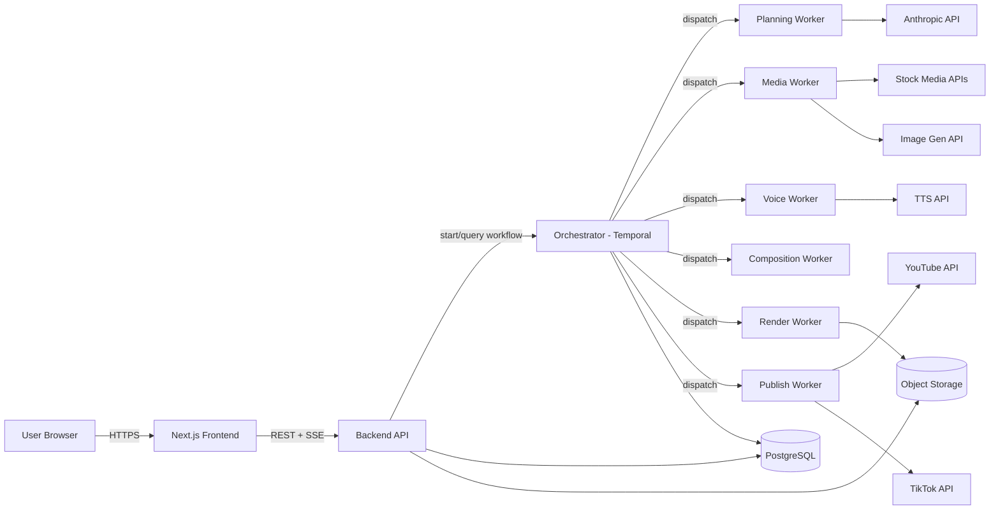
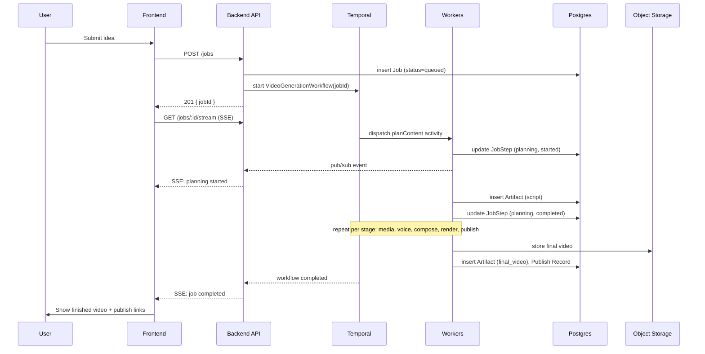
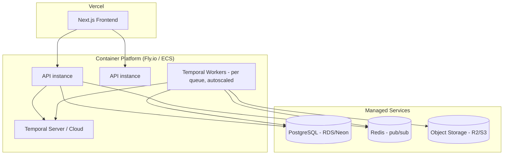

# e2ecg — Architecture Document

Version 1.0 · Companion to `README.md` · Status: Planning / Pre-implementation

## 1. Purpose and Scope

This document describes the technical architecture for e2ecg in enough detail to start implementation: system boundaries, component responsibilities, data flow, schema, API contracts, orchestration logic, deployment topology, and failure handling. Product requirements are defined in the README and are not repeated here except where needed for context.

Think of the system as a **restaurant with an expo line**: the frontend is the dining room where customers place and track orders, the backend API is the front counter that takes the order and files it, the orchestrator is the expo who tracks every ticket across every station, and the workers are the stations themselves (grill, salad, plating) — each independently staffed and scaled.

## 2. System Context



## 3. Component Architecture

### 3.1 Frontend — Next.js (TypeScript)

- **App Router**, mixing Server Components (job history, account pages — data fetched server-side from the API) with Client Components (live progress view, forms).
- **Live progress**: subscribes to `GET /jobs/:id/stream` (SSE) and renders per-stage status without polling.
- **State management**: server state via React Query (or SWR) for caching job lists/detail; no global client store needed since most state is server-owned.
- **Auth**: Clerk SDK handles session, exposes a session token the frontend forwards to the backend API on each request.
- **Key routes**:
  - `/dashboard` — job list + filters/search (Server Component, paginated)
  - `/jobs/new` — idea submission form
  - `/jobs/[id]` — live progress + artifact viewer (Client Component for the stream)
  - `/settings/integrations` — YouTube/TikTok connection management

### 3.2 Backend API — NestJS on Node.js

Responsibilities: auth verification, request validation, job CRUD, starting/querying orchestrator workflows, serving artifact metadata, proxying SSE from the orchestrator/event bus to the browser.

Modules:
- `AuthModule` — verifies Clerk session tokens, attaches `userId` to the request context.
- `JobsModule` — `POST /jobs` validates input, writes a `Job` row, starts a Temporal workflow with the job id as workflow id (guarantees one workflow per job — see idempotency note in §7).
- `ArtifactsModule` — signed URL generation for reading objects from storage (never exposes storage credentials to the client).
- `IntegrationsModule` — OAuth flows for YouTube/TikTok, encrypted token storage, token refresh.
- `StreamModule` — subscribes to a per-job Redis pub/sub channel (or Temporal's workflow query API) and forwards events to the browser as SSE.

The API is **stateless** — it holds no in-memory job state — so it can scale horizontally behind a load balancer without sticky sessions (SSE connections are per-request but the underlying job state lives in Postgres/Temporal, not in API process memory).

### 3.3 Orchestrator — Temporal

The orchestrator is the piece that turns "call six APIs in order, handle failures, remember where you left off" from application code into a durable guarantee.

- One **Workflow** definition, `VideoGenerationWorkflow`, per job. Workflow id = `job:{jobId}` (idempotency: starting the same job id twice reuses/rejects the duplicate rather than double-running the pipeline).
- Each pipeline stage is a Temporal **Activity**: `planContent`, `draftScript`, `collectMedia`, `generateVoice`, `composeTimeline`, `renderVideo`, `publishContent`.
- Activities are executed by **Workers** — separate Node.js processes, one deployable per activity type (or grouped by resource profile — see §3.4).
- Temporal handles: automatic retries with exponential backoff per activity, timeouts, and durable state — if a worker process dies mid-render, Temporal reschedules the activity on another worker without losing the workflow's place.
- The workflow emits progress by writing a `JobStep` row to Postgres at the start/end of each activity, and publishing an event to Redis pub/sub for the SSE stream to pick up. Temporal state itself is the source of truth for resumability; Postgres is the source of truth for what the UI displays.

Pseudocode sketch of the workflow:

```typescript
export async function VideoGenerationWorkflow(input: JobInput): Promise<JobResult> {
  await recordStep('planning', 'started');
  const plan = await activities.planContent(input);
  await recordStep('planning', 'completed');

  await recordStep('script_drafting', 'started');
  const script = await activities.draftScript(plan);
  await recordStep('script_drafting', 'completed');

  const [media, voice] = await Promise.all([
    withStep('media_collection', () => activities.collectMedia(script)),
    withStep('voice_generation', () => activities.generateVoice(script)),
  ]);

  const timeline = await withStep('video_composition', () =>
    activities.composeTimeline(script, media, voice)
  );

  const video = await withStep('rendering', () =>
    activities.renderVideo(timeline)
  );

  const publishResults = await withStep('uploading', () =>
    activities.publishContent(video, input.targetPlatforms)
  );

  return { video, publishResults };
}
```

Media collection and voice generation are independent of each other (both only depend on the script) and run in parallel — this alone can meaningfully cut end-to-end latency, and is a natural fit once the pipeline is modeled as a workflow rather than a linear queue chain.

### 3.4 Worker Services

Each activity type is deployed as its own worker pool so scaling and resource allocation match the actual cost profile of the work:

| Worker | Resource Profile | Scaling Trigger | Notes |
|---|---|---|---|
| Planning / Script | Low CPU, network-bound (LLM call) | Queue depth | Calls Anthropic API with structured/tool-use output for a typed script object |
| Media Collection | Low CPU, network-bound | Queue depth | Queries stock APIs first; falls back to generative image API only on no-match, per licensing policy |
| Voice Generation | Low CPU, network-bound | Queue depth | Calls TTS provider; stores resulting audio in object storage, writes an `Artifact` row |
| Composition | Medium CPU | Queue depth | Runs Remotion in "calculate metadata" / timeline-assembly mode — produces a render spec, not yet a final video file |
| Render | High CPU (and optionally GPU for hardware-accelerated encoding) | Queue depth + concurrency cap | Runs Remotion's renderer + FFmpeg for final encode; most expensive stage, isolated so it can scale independently and use larger/cheaper spot instances |
| Publish | Low CPU, network-bound, rate-limit sensitive | Queue depth | Wraps YouTube/TikTok upload APIs; enforces per-provider idempotency keys |

Workers are Temporal Worker processes (Node.js), each polling only its own task queue (`e2ecg-planning`, `e2ecg-render`, etc.), which is what allows independent autoscaling per stage.

## 4. Data Flow (Sequence)



## 5. Data Model (Schema-Level Detail)

Extends the conceptual model in the README with concrete types.

```sql
users
  id                uuid primary key
  email             text unique not null
  auth_provider_id  text unique
  profile           jsonb
  created_at        timestamptz default now()

jobs
  id                uuid primary key
  user_id           uuid references users(id)
  idea_input        text not null
  audience          text
  tone              text
  target_platforms  text[]        -- e.g. {youtube, tiktok}
  constraints       jsonb         -- duration, style, cta, language
  status            text not null -- queued|planning|script_drafting|media_collection|
                                   -- voice_generation|video_composition|uploading|completed|failed
  workflow_id       text unique   -- Temporal workflow id, = 'job:' || id
  created_at        timestamptz default now()
  updated_at        timestamptz default now()

job_steps
  id                uuid primary key
  job_id            uuid references jobs(id)
  step_name         text not null
  status            text not null  -- pending|started|completed|failed|retrying
  started_at        timestamptz
  finished_at       timestamptz
  error_detail      jsonb
  retry_count       int default 0

artifacts
  id                uuid primary key
  job_id            uuid references jobs(id)
  type              text not null  -- script|image|clip|voice|final_video
  uri               text not null  -- object storage key
  metadata          jsonb          -- duration, resolution, voice provider, etc.
  created_at        timestamptz default now()

platform_accounts
  id                uuid primary key
  user_id           uuid references users(id)
  provider          text not null  -- youtube|tiktok
  access_token_enc  bytea not null
  refresh_token_enc bytea
  token_expiry      timestamptz
  created_at        timestamptz default now()

publish_records
  id                uuid primary key
  job_id            uuid references jobs(id)
  provider          text not null
  remote_content_id text
  remote_url        text
  idempotency_key   text unique not null
  published_at      timestamptz
  response_summary  jsonb
```

Indexes worth adding immediately: `jobs(user_id, created_at desc)` for history browsing, `job_steps(job_id)`, `artifacts(job_id)`.

## 6. API Contracts (Key Endpoints)

### `POST /jobs`
```json
// Request
{
  "ideaInput": "5 productivity tips for remote workers",
  "audience": "young professionals",
  "tone": "energetic",
  "targetPlatforms": ["youtube", "tiktok"],
  "constraints": { "durationSeconds": 60, "language": "en", "cta": "Follow for more" }
}
// Response 201
{ "jobId": "b1e2...", "status": "queued" }
```

### `GET /jobs/:id/stream` (SSE)
```
event: step_update
data: {"step":"planning","status":"started","timestamp":"..."}

event: step_update
data: {"step":"planning","status":"completed","timestamp":"..."}

event: job_completed
data: {"jobId":"b1e2...","status":"completed","artifacts":[...]}
```

### `POST /jobs/:id/retry`
Re-signals the existing Temporal workflow to retry from the failed activity rather than starting a new workflow — preserves already-completed artifacts (script, media, voice) instead of regenerating everything.

### `POST /jobs/:id/publish`
```json
// Request
{ "providers": ["youtube"] }
// Response 202 — publish activity enqueued, progress via SSE as usual
```

## 7. Idempotency and Retry Strategy

- **Workflow-level idempotency**: Temporal workflow id = `job:{jobId}`. Starting a workflow with an id already in use returns the existing workflow handle instead of creating a duplicate — this makes `POST /jobs/:id/retry` safe to call multiple times.
- **Activity-level retries**: each activity has a retry policy (initial interval, backoff coefficient, max attempts) tuned per activity — e.g., LLM calls retry aggressively on 429s, publish activities retry conservatively given platform rate limits.
- **Publish idempotency**: a deterministic `idempotency_key` (hash of `jobId + provider`) is passed to the upload activity and stored on the `publish_records` row before the network call is made, so a retried publish activity can check "did I already succeed?" before re-uploading and creating a duplicate video on the platform.

## 8. Storage Layout

Object storage (S3-compatible) organized by job for easy lifecycle management and access control:

```
/{userId}/{jobId}/script.json
/{userId}/{jobId}/media/{assetId}.mp4|.jpg
/{userId}/{jobId}/voice/narration.mp3
/{userId}/{jobId}/render/final.mp4
/{userId}/{jobId}/render/final_captions.srt
```

- Access is via short-lived signed URLs issued by the API — the client never talks to storage directly.
- A lifecycle policy can move `media/*` (often re-derivable) to cheaper/cold storage after N days while keeping `render/final.mp4` (the user-facing deliverable) in standard storage.

## 9. Real-Time Updates (Event Schema)

Workers publish to a Redis pub/sub channel keyed by `job:{jobId}:events`. The API's `StreamModule` subscribes per active SSE connection and relays events. Event shape:

```json
{
  "jobId": "b1e2...",
  "step": "video_composition",
  "status": "started" ,
  "timestamp": "2026-08-20T10:15:00Z",
  "meta": { "retryCount": 0 }
}
```

This same event is also durably written to `job_steps`, so a user who refreshes mid-job (missing live events) gets the same picture from a plain `GET /jobs/:id/steps` call — SSE is a convenience layer, not the source of truth.

## 10. Deployment Topology



- **Frontend** on Vercel — global edge network, no server management.
- **API** deployed as 2+ instances behind a load balancer, stateless, autoscales on CPU/connection count.
- **Temporal**: use Temporal Cloud initially to avoid operating the Temporal server yourself; migrate to self-hosted only if cost or data-residency requires it.
- **Workers**: one autoscaling group per task queue, so `render` workers (expensive, CPU-heavy) scale independently from `planning` workers (cheap, I/O-bound). Render workers are a good candidate for spot/preemptible instances given Temporal's activity retry already tolerates worker loss.
- **Postgres**: managed (RDS, Neon, or Supabase) with automated backups; add a read replica once history/search queries start competing with write-heavy job traffic.
- **Redis**: managed instance, used only for pub/sub and any lightweight BullMQ queues (e.g., outbound email) — not for durable job state.

## 11. Security Architecture

- All inter-service calls over TLS; API validates Clerk session JWTs on every request.
- OAuth tokens for YouTube/TikTok encrypted at rest using envelope encryption (KMS-managed data key per token); decrypted only inside the publish worker's process memory, never logged.
- Per-user row-level isolation enforced at the query layer (every `jobs`/`artifacts` query scoped by `user_id` derived from the authenticated session, not from client input).
- Signed, short-TTL URLs for all storage reads/writes — no long-lived public buckets.
- Content safety filter (moderation API call) runs as an activity between `composeTimeline` and `publishContent`, so generated content is checked before it ever reaches a platform's public API.

## 12. Observability

- **Tracing**: OpenTelemetry spans across API → Temporal workflow → activities, exported to Grafana Cloud or Datadog. A single trace should let you click from "job took 4 minutes" down to "the render activity took 3 of those minutes."
- **Metrics**: per-stage duration histograms, per-stage failure rate, external API latency (Anthropic, TTS, stock media, YouTube, TikTok) and quota/rate-limit consumption — feeds directly into the README's "failure rate per pipeline stage" and "publish success rate by platform" success metrics.
- **Logging**: structured JSON logs from every worker, correlated by `jobId` and Temporal `workflowId`/`runId`.
- **Alerting**: threshold alerts on stage failure rate and on queue depth per task queue (a growing `render` queue with flat worker count is the first sign you need to scale that pool).

## 13. Open Questions / Decisions to Revisit

- Self-hosted Temporal vs Temporal Cloud — revisit once volume or cost projections are clearer.
- Whether composition (Remotion timeline assembly) and rendering should be one activity or two — currently split so a composition bug doesn't waste an expensive render, but this adds a hop; worth revisiting after real timing data exists.
- GPU-accelerated encoding for render workers — evaluate once render duration/cost becomes a bottleneck; not needed for MVP volumes.