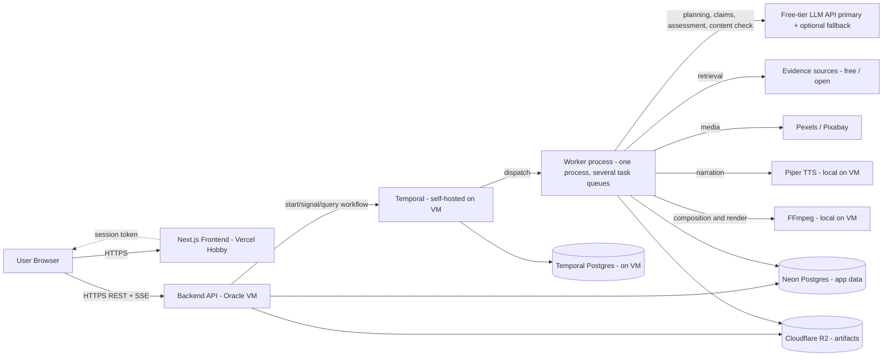
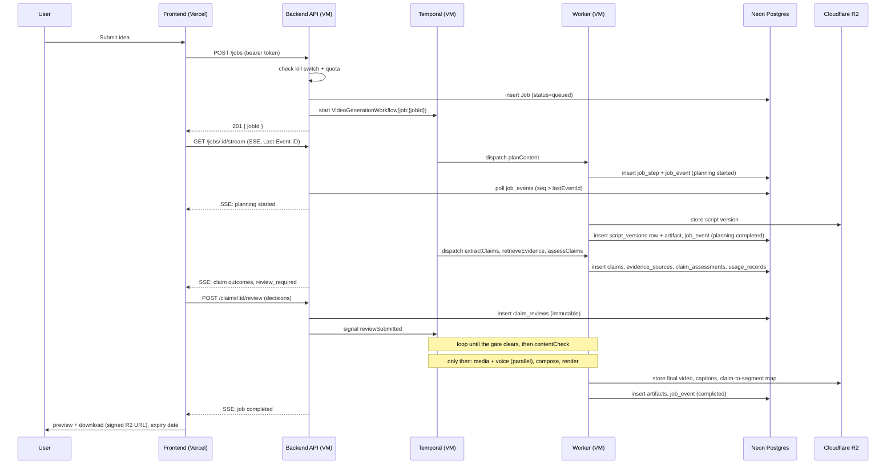
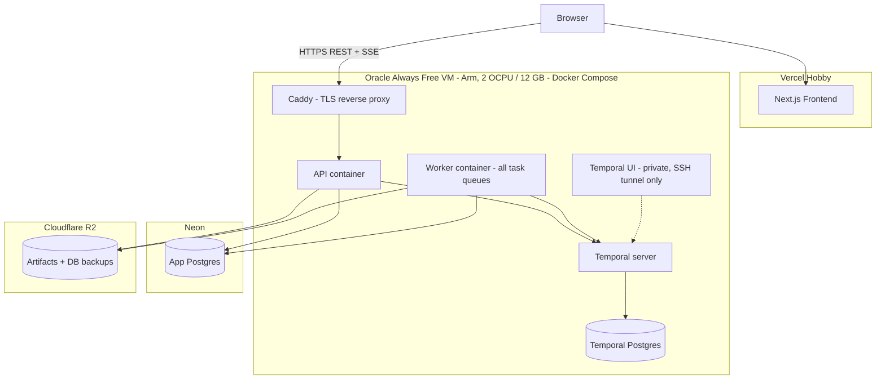

# e2ecg — Architecture Document

Version 1.2 · Companion to `README.md` (v1.2) and `todo.md` (v1.2) · Status: Planning / Pre-implementation

## 1. Purpose and Scope

This document describes the technical architecture for e2ecg in enough detail to start implementation: system boundaries, component responsibilities, data flow, schema, API contracts, orchestration logic, deployment topology, quota controls, and failure handling. Product requirements are defined in the README and are not repeated here except where needed for context. Free-tier allowances (the numbers that change) live in one place, the README's **Free-Tier Reality Check**; this document only describes their architectural consequences.

**Scope of this version:** a publicly reachable deployment on free-tier cloud platforms, at zero recurring cost, with a local Docker Compose stack for development. Paid/managed mode, publishing integrations, email, and the full observability stack are deferred (see §17).

The fact-checking layer is a first-class workflow gate: it assesses extracted claims against retrieved evidence and never silently treats missing evidence as proof that a claim is false. A check that could not run is recorded as **incomplete**, never as an evidence outcome.

Think of the system as a **food truck with rented storage**. The dining counter (frontend) takes and tracks orders, the front window (API) files each ticket, the expo (orchestrator) tracks every ticket across every station, and the stations (workers) do the cooking, all on one small truck (the free VM). The pantry (database) and the cold storage (object storage) are rented off the truck, so if the truck is towed, the inventory survives and a new truck can be driven in.

## 2. System Context



The browser talks to two origins: the **frontend** (Vercel) for pages, and the **API** (the VM, behind Caddy) for data and the SSE stream. The frontend never proxies SSE, because Vercel functions are not suited to long-lived streams on the free plan.

Fact-checking activities use an LLM for structured extraction and evidence assessment, but every assessment stays linked to the retrieved source metadata and excerpts. Retrieved pages are evidence data, not instructions.

## 3. Component Architecture

### 3.1 Frontend — Next.js (TypeScript) on Vercel Hobby

- **App Router**, mixing Server Components (job history, account pages) with Client Components (live progress view, claim review, forms).
- **Live progress**: opens an `EventSource` directly to `GET {API}/jobs/:id/stream` and renders per-stage status. On reconnect the browser sends `Last-Event-ID` automatically and the API replays missed events (§9). A plain `GET /jobs/:id/steps` plus `GET /jobs/:id/claims` is the fallback.
- **State management**: server state via React Query (or SWR); no global client store.
- **Auth**: Auth.js runs inside the Next.js app and issues a signed session token (JWT). The frontend forwards the token to the API as a bearer token. The API validates the signature on every request (§12).
- **Key routes**:
  - `/dashboard` — job list, filters, search (Server Component, paginated)
  - `/jobs/new` — idea submission form (shows remaining daily quota from `GET /quota`)
  - `/jobs/[id]` — live progress, claim review, artifact viewer, download, expiry date
  - `/settings` — account page, including account/data deletion
- **Hosting constraint**: Vercel Hobby is personal, non-commercial use only and pauses the project when a cap is reached. The UI is therefore kept light (few Server Component data fetches, no image optimization of user video). If the project is ever monetized, host the UI where the terms allow it.

### 3.2 Backend API — NestJS on Node.js (VM, behind Caddy)

Responsibilities: token verification, request validation, quota enforcement, job CRUD, starting/signaling/querying orchestrator workflows, serving artifact metadata and signed URLs, and streaming job events over SSE.

Modules:
- `AuthModule` — verifies the Auth.js-issued JWT, attaches `userId` to the request context. All routes except `GET /health` require it.
- `JobsModule` — `POST /jobs` validates input, enforces quota and the intake kill switch (§14), writes a `Job` row, and starts a Temporal workflow with the job id as workflow id (§7).
- `ClaimsModule` — serves claims, assessments, evidence references, and review decisions; records review decisions and signals the workflow; enforces the owning user's job scope.
- `ArtifactsModule` — signed URL generation for reading objects from storage, and signed upload URLs for user-provided assets (type and size limited). Never exposes storage credentials.
- `StreamModule` — SSE endpoint that reads persisted `job_events` for the job (§9).
- `QuotaModule` — computes remaining per-user and global capacity and serves `GET /quota`.
- `HealthModule` — `GET /health` for the uptime monitor and deployment checks (database, Temporal, storage reachability).

The API is **stateless**: it holds no in-memory job state. There is a single API instance in this deployment, but nothing in the design prevents running more.

CORS is restricted to the deployed UI origin. Only ports 80/443 are exposed on the VM (§11.5).

### 3.3 Orchestrator — Temporal (self-hosted on the VM)

The orchestrator turns "call several APIs in order, handle failures, remember where you left off" from application code into a durable guarantee. Temporal Cloud is not used, because it offers trial credits but no permanent free tier.

- One **Workflow** definition, `VideoGenerationWorkflow`, per job. Workflow id = `job:{jobId}` (§7 explains duplicate-start and recovery behavior).
- Each pipeline stage is a Temporal **Activity**: `planContent`, `draftScript`, `extractClaims`, `retrieveEvidence`, `assessClaims`, `applyReviewGate`, `reviseScript`, `contentCheck`, `collectMedia`, `generateVoice`, `composeTimeline`, `renderVideo`. A few small helper activities (`recordStep`, `setJobState`) write bookkeeping rows.
- Temporal handles automatic retries with backoff, timeouts, and durable state: if the worker process dies mid-render, the activity is rescheduled when the worker returns.
- **State of record**: the app database (Neon) is the source of truth for what the UI shows (job state, steps, events, claims). Temporal state is the source of truth for resumability only, and is *expected to be disposable*: if the VM is rebuilt, Temporal history is gone and recovery goes through the reconciliation path in §7.3.

**Workflow rules** (these avoid common orchestration pitfalls):
1. **Pass references, not payloads.** Activities exchange IDs and storage keys (`scriptVersionId`, `artifactId`), never script bodies, media, or video bytes. Orchestrator payloads have size limits, and a delivery receipt is cheaper to move than the sofa.
2. **Workflow code is deterministic.** All database writes and event emission happen inside activities, never directly in workflow code.
3. **Long activities heartbeat** (rendering especially) and have explicit start-to-close and heartbeat timeouts.
4. **Failure parks the workflow; it does not end it.** When an activity exhausts its retries, `stage()` records the failure, sets the job to `failed`, and waits for a `retryStage` or `cancel` signal.
5. **Quota exhaustion is not a transient error.** It is raised as a non-retryable error (§14), so retries are not wasted against a limit that resets hours later.
6. **The review loop is a real loop**, capped by `MAX_REVISION_ROUNDS`, driven by signals, and fed by the user's recorded decisions.
7. **Production never starts before the gate.** Media, voice, composition, and rendering begin only after the review gate clears and the content check passes.

Pseudocode sketch of the workflow:

```typescript
const reviewSubmitted = defineSignal<[ReviewSubmission]>('reviewSubmitted');
const retryStage      = defineSignal('retryStage');
const cancelJob       = defineSignal('cancelJob');

export async function VideoGenerationWorkflow(input: JobInput): Promise<JobResult> {
  const { jobId } = input;

  const plan = await stage(jobId, 'planning', () => a.planContent(input));          // returns an artifact ref
  let scriptVersionId = await stage(jobId, 'script_drafting', () => a.draftScript(plan));

  // --- Fact-check and review loop ---------------------------------------------
  for (let round = 1; ; round++) {
    const claimIds = await stage(jobId, 'claim_extraction',  () => a.extractClaims(scriptVersionId));
    await stage(jobId, 'evidence_retrieval', () => a.retrieveEvidence(claimIds, round));
    await stage(jobId, 'claim_assessment',   () => a.assessClaims(claimIds, round));

    const gate = await a.applyReviewGate(scriptVersionId, round);   // flagged + incomplete claims
    if (gate.clear) break;                                          // all claims may proceed under policy

    await a.setJobState(jobId, 'review_required', { flagged: gate.flaggedCount, roundCapReached: round >= MAX_ROUNDS });
    const review = await waitForReview();                           // signal sent by the API once every flagged claim has a decision

    if (review.action === 'cancel')  return cancelled(jobId);
    if (review.action === 'proceed') break;                         // every flagged claim explicitly accepted (immutable claim_reviews rows)
    if (round >= MAX_ROUNDS)         { await a.setJobState(jobId, 'review_required', { roundCapReached: true }); continue; } // only proceed/cancel allowed

    await a.setJobState(jobId, 'revising');
    scriptVersionId = await a.reviseScript(scriptVersionId, review); // decisions + optional user edits -> new script_versions row
  }

  await a.setJobState(jobId, 'ready_for_production');
  await stage(jobId, 'content_check', () => a.contentCheck(scriptVersionId));   // moderation on the approved script

  // --- Production (parallel stations) -----------------------------------------
  const [media, voice] = await Promise.all([
    stage(jobId, 'media_collection',  () => a.collectMedia(scriptVersionId)),
    stage(jobId, 'voice_generation',  () => a.generateVoice(scriptVersionId)),
  ]);
  const renderSpec = await stage(jobId, 'video_composition', () => a.composeTimeline(scriptVersionId, media, voice));
  const video      = await stage(jobId, 'rendering',         () => a.renderVideo(renderSpec));

  await a.setJobState(jobId, 'completed');
  return { video };
}

// Records start/finish, and on exhausted retries parks the workflow awaiting retry or cancel.
async function stage<T>(jobId: string, name: StepName, run: () => Promise<T>): Promise<T> {
  for (;;) {
    await a.recordStep(jobId, name, 'started');
    try {
      const out = await run();
      await a.recordStep(jobId, name, 'completed');
      return out;
    } catch (err) {
      await a.recordStep(jobId, name, 'failed', describe(err));
      await a.setJobState(jobId, 'failed', describe(err));
      await waitForRetryOrCancel();      // resolves on retryStage; throws a cancellation on cancelJob
    }
  }
}
```

Notes on the sketch:
- `applyReviewGate` treats `incomplete` and `skipped_by_limit` checks as flagged, so a quota-starved assessment can never slip through as "verified".
- At the round cap, the automatic revise path is disabled; the user can only accept every remaining flagged claim explicitly, or cancel. This bounds quota use.
- Unchanged claims in a revised script reuse their previous assessment (a new row with `reused_from_assessment_id`), so a revision round does not re-spend quota on settled claims.
- `Promise.all` for media and voice is safe in Temporal workflow code, because both calls are activities.

### 3.4 Worker Services

Start with **one worker process** that registers every activity and polls several task queues, one per resource profile. Queues exist so concurrency can be set per stage today and so a stage can be split into its own deployable later, **only if measurement justifies it**. Render is the first candidate.

| Task queue | Activities | Resource profile | Concurrency | Notes |
|---|---|---|---|---|
| `e2ecg-planning` | `planContent`, `draftScript`, `reviseScript`, `contentCheck` | Network-bound (LLM) | Low (bounded by provider RPM) | Calls the LLM through the quota-guarded provider (§10.1). Structured output validated against a typed schema; retry-with-repair on malformed output. |
| `e2ecg-fact-checking` | `extractClaims`, `retrieveEvidence`, `assessClaims`, `applyReviewGate` | Network-bound (LLM + search) | Low | Extraction preserves script locations; retrieval stores URLs/metadata and minimal excerpts and records failures as incomplete checks; assessment uses only supplied evidence and never presents model judgment as proof. |
| `e2ecg-media` | `collectMedia` | Network-bound | Low | Stock APIs (Pexels/Pixabay) and user-provided assets; license/provenance recorded per asset. |
| `e2ecg-voice` | `generateVoice` | CPU (Piper) | 1 | Synthesizes **per script segment**, so segment durations drive the timeline and captions. Stores audio in object storage and writes `artifacts` rows. |
| `e2ecg-composition` | `composeTimeline` | Low CPU | 1 | Produces a `RenderSpec` (JSON), not a video file. Enforces the duration cap. |
| `e2ecg-render` | `renderVideo` | High CPU / memory | **1** | Translates the `RenderSpec` to an FFmpeg filter graph (below). Most expensive stage; fixed at one concurrent render on the 2-OCPU VM. |

**Composition and rendering design (FFmpeg-first).** Headless-browser rendering is memory-heavy for a 12 GB VM, so the MVP composes with FFmpeg directly:
- `composeTimeline` builds a `RenderSpec`: ordered segments (stable `segmentId`, media reference, duration from the Piper audio), caption cues, audio references, and the output preset (resolution, fps, duration cap).
- `renderVideo` runs FFmpeg: scale/crop each asset to the preset, apply a simple motion effect to still images, concatenate segments, burn in captions, mix narration, and encode H.264 + AAC with fast-start. Defaults favor speed over size (for example 720×1280 vertical, 30 fps, a fast encoder preset, thread count capped).
- The activity parses FFmpeg's progress output to **heartbeat** to Temporal and to emit coarse progress events.
- It also writes the `.srt` captions and a **claim-to-segment map** (`claim_id → segmentId → start/end`) as artifacts, which provides the traceability the README asks for.
- Remotion-based templates are a post-MVP enhancement (§17), once resource use and license terms are verified.

### 3.5 Maintenance Workflows

Small Temporal **Schedules** (or cron-style workflows) run on the same worker:

| Workflow | Cadence | Purpose |
|---|---|---|
| `ReconciliationWorkflow` | At API startup and every few minutes | Finds jobs in non-terminal states with no live workflow and marks them `failed` with reason `workflow_lost` and a retry path (§7.3). |
| `RetentionSweepWorkflow` | Daily | Deletes expired artifacts from object storage, marks jobs `expired`, and prunes stale evidence excerpts (§8). |
| `DatabaseBackupWorkflow` | Weekly | Runs `pg_dump` of the app database to a separate object-storage prefix and keeps the last few dumps (§11.7). |
| `QuotaWatchWorkflow` | Hourly | Computes usage against configured ceilings and emits `quota_warning` log events and an admin-page banner at about 80% (§14). |

## 4. Data Flow (Sequence)



## 5. Data Model (Schema-Level Detail)

Extends the conceptual model in the README with concrete types. **Two schema-level refinements to note:**
1. **Evidence is keyed by claim and round, then linked to the assessment that used it**, because retrieval physically happens before assessment. The conceptual relationship in the README (an assessment's evidence) is preserved through the `assessment_evidence` join table.
2. **Script bodies live in object storage**, not in the database. The database stores the storage key and small metadata, which keeps the free database within its size cap.

```sql
users                                   -- plus the adapter tables Auth.js requires
  id                uuid primary key
  email             text unique not null
  auth_provider_id  text unique
  profile           jsonb
  created_at        timestamptz default now()

jobs
  id                uuid primary key
  user_id           uuid references users(id) on delete cascade
  idea_input        text not null
  audience          text
  tone              text
  output_format     text not null          -- vertical_9_16 | landscape_16_9
  constraints       jsonb                  -- duration, style, cta, language
  status            text not null          -- canonical job states (see below)
  status_detail     jsonb                  -- flagged count, round cap reached, failure reason
  workflow_id       text unique            -- 'job:' || id
  revision_round    int default 0
  artifacts_expire_at timestamptz
  created_at        timestamptz default now()
  updated_at        timestamptz default now()
-- Canonical states (shared by DB, SSE, UI):
--   queued | planning | script_drafting | claim_extraction | evidence_retrieval |
--   claim_assessment | review_required | revising | ready_for_production |
--   content_check | media_collection | voice_generation | video_composition |
--   rendering | completed | failed | cancelled | expired
-- media_collection and voice_generation run in parallel; the job row shows the
-- most recently started of the two, and job_steps carries both.

job_steps
  id                uuid primary key
  job_id            uuid references jobs(id) on delete cascade
  step_name         text not null
  attempt           int not null default 1
  status            text not null          -- pending|started|completed|failed|retrying
  started_at        timestamptz
  finished_at       timestamptz
  error_detail      jsonb
  retry_count       int default 0
  unique (job_id, step_name, attempt)

job_events                              -- source of truth for the SSE stream
  seq               bigserial primary key  -- monotonically increasing; gaps are allowed
  job_id            uuid references jobs(id) on delete cascade
  event_type        text not null          -- step_update | fact_check_update | job_state | job_completed | job_failed
  payload           jsonb not null
  workflow_run_id   text
  created_at        timestamptz default now()

script_versions
  id                uuid primary key
  job_id            uuid references jobs(id) on delete cascade
  version_number    int not null
  content_key       text not null          -- object-storage key of the script JSON (segments with stable segmentId)
  segment_count     int
  word_count        int
  revision_reason   text
  created_at        timestamptz default now()
  unique (job_id, version_number)

claims
  id                uuid primary key
  job_id            uuid references jobs(id) on delete cascade
  script_version_id uuid references script_versions(id) on delete cascade
  claim_text        text not null
  segment_id        text not null          -- stable script segment id
  location          jsonb not null         -- paragraph / sentence offsets within the segment
  claim_type        text                   -- statistic|date_event|attribution|causal_scientific|other
  checkable         boolean not null default true
  non_checkable_reason text                -- opinion|prediction|subjective|other
  extraction_meta   jsonb
  created_at        timestamptz default now()

claim_assessments                       -- append-only: a recheck adds rows, never edits them
  id                uuid primary key
  claim_id          uuid references claims(id) on delete cascade
  round             int not null
  check_state       text not null          -- completed | incomplete | skipped_by_limit
  outcome           text                   -- supported|contradicted|unsupported|insufficient_or_conflicting
  rationale         text
  assessment_meta   jsonb                  -- provider, model, prompt version, timing
  failure_reason    text                   -- timeout|quota_exhausted|provider_error|...
  reused_from_assessment_id uuid references claim_assessments(id)
  created_at        timestamptz default now()
  check ((check_state = 'completed') = (outcome is not null))   -- an incomplete check has no outcome

evidence_sources
  id                uuid primary key
  claim_id          uuid references claims(id) on delete cascade
  round             int not null
  url               text not null
  title             text
  publisher         text
  published_at      timestamptz
  retrieved_at      timestamptz not null
  excerpt           text                   -- minimal, and only where source terms permit
  direction         text                   -- supports|contradicts|context
  quality_notes     text
  content_hash      text

assessment_evidence                     -- which sources each assessment actually used
  assessment_id     uuid references claim_assessments(id) on delete cascade
  evidence_id       uuid references evidence_sources(id) on delete cascade
  primary key (assessment_id, evidence_id)

claim_reviews                           -- immutable once written
  id                uuid primary key
  claim_id          uuid references claims(id) on delete cascade
  assessment_id     uuid references claim_assessments(id)
  decision          text not null          -- accept|revise|remove|request_review
  reviewer_type     text not null          -- user|system
  rationale         text
  resulting_script_version_id uuid references script_versions(id)
  created_at        timestamptz default now()

artifacts
  id                uuid primary key
  job_id            uuid references jobs(id) on delete cascade
  script_version_id uuid references script_versions(id)
  step_name         text
  type              text not null          -- script|evidence_report|image|clip|voice|final_video|captions|claim_segment_map
  storage_key       text not null
  size_bytes        bigint
  metadata          jsonb                  -- duration, resolution, voice, license/provenance for media
  created_at        timestamptz default now()
  expires_at        timestamptz

usage_records
  id                uuid primary key
  job_id            uuid references jobs(id) on delete set null
  user_id           uuid references users(id) on delete cascade
  provider          text not null
  operation         text not null          -- llm_call|search|tts|render|...
  units             numeric not null
  unit_type         text not null          -- requests|tokens|searches|characters|render_seconds
  created_at        timestamptz default now()
```

Indexes worth adding immediately: `jobs(user_id, created_at desc)`, `job_steps(job_id)`, `job_events(job_id, seq)`, `claims(job_id, script_version_id)`, `claim_assessments(claim_id, created_at desc)`, `evidence_sources(claim_id, round)`, `claim_reviews(claim_id, created_at desc)`, `artifacts(job_id)`, `artifacts(expires_at)`, `usage_records(provider, created_at)`, and `usage_records(user_id, created_at)`.

**Neon notes.** Use the **pooled** connection string for the API and worker, and the direct connection for migrations. The first query after an idle period may be slow because the database scales to zero, so database clients retry connection errors briefly (§7.4). Do not hold long-lived `LISTEN` connections open: they would keep compute awake and consume the free allowance (§9).

**Deferred schema.** `platform_accounts` and `publish_records` (OAuth tokens and publish idempotency) are not part of this version; see §17.

## 6. API Contracts (Key Endpoints)

All endpoints except `GET /health` require a valid bearer token. Ownership is derived from the token, never from client-supplied IDs.

### `POST /jobs`
```json
// Request
{
  "ideaInput": "5 productivity tips for remote workers",
  "audience": "young professionals",
  "tone": "energetic",
  "outputFormat": "vertical_9_16",
  "constraints": { "durationSeconds": 60, "language": "en", "cta": "Follow for more" }
}
// Response 201
{ "jobId": "b1e2...", "status": "queued" }
// Response 429 (per-user or global daily limit reached)
{ "error": "at_capacity", "scope": "global", "resetsAt": "2026-10-11T07:00:00Z" }
// Response 503 (intake kill switch is on)
{ "error": "intake_paused" }
```
`outputFormat` selects a resolution and duration preset only; it never triggers publishing.

### `GET /jobs/:id/stream` (SSE)
Every event carries an `id` equal to its `job_events.seq`, so the browser's automatic `Last-Event-ID` header replays missed events.
```
id: 1042
event: step_update
data: {"step":"planning","status":"started","timestamp":"..."}

id: 1051
event: fact_check_update
data: {"step":"claim_assessment","state":"review_required","claimCount":4,"flaggedCount":2,"incompleteCount":1,"timestamp":"..."}

id: 1060
event: job_completed
data: {"jobId":"b1e2...","status":"completed","expiresAt":"..."}
```
Other event types: `job_state`, `job_failed`. A comment line (`: keep-alive`) is sent periodically. The stream closes after a terminal state.

### Claims and Evidence
- `GET /jobs/:id/claims` — claims for the latest or a requested script version, with the latest assessment (check state and outcome) and review state.
- `GET /claims/:id` — the claim, script location, assessment history, rationale, and audit metadata.
- `GET /claims/:id/evidence` — source metadata, excerpts where permitted, retrieval timestamps, and evidence direction.
- `POST /claims/:id/review` — records `accept`, `revise`, `remove`, or `request_review` as an immutable audit row. When every flagged claim in the current round has a decision, the API sends the `reviewSubmitted` signal to the workflow.
- `POST /jobs/:id/recheck` — submits optional user script edits and requests a new round: creates a new script version and a new assessment set without overwriting prior results. Rejected with a clear error once the round cap is reached.

### Job Control
- `POST /jobs/:id/retry` — two paths (see §7): if the workflow is alive and parked after a failure, send `retryStage`; if the workflow no longer exists (for example after a VM rebuild), start a fresh run that resumes from the last completed artifacts.
- `POST /jobs/:id/cancel` — signals `cancelJob`; the job ends in `cancelled`.
- `DELETE /jobs/:id` — cancels any running workflow, deletes the job's artifacts from object storage, and removes its rows (claims, evidence, assessments, events).
- `GET /jobs`, `GET /jobs/:id`, `GET /jobs/:id/steps`, `GET /jobs/:id/artifacts` — reads, scoped to the owner.
- `GET /jobs/:id/usage` — provider usage for the job against its limits.

### Quota and Health
- `GET /quota` — the caller's remaining daily jobs and the global capacity state (`ok`, `near_limit`, `at_capacity`, `paused`) with the next reset time.
- `GET /health` — unauthenticated liveness plus dependency checks.

### Uploads (user-provided assets)
- `POST /uploads` — returns a short-lived signed upload URL for an allowed media type; size and count are capped per job.

## 7. Idempotency, Retry, and Recovery

### 7.1 Workflow-level idempotency
- Workflow id = `job:{jobId}`. Temporal's default is to *reject* a duplicate start of a running workflow id, and what happens after a run closes depends on the **ID conflict and ID reuse policies**. The API sets these explicitly in the start options (running duplicate → return the existing run; closed run → allow a new run only through the retry path) and an integration test asserts the behavior, instead of assuming it.
- The `jobs.workflow_id` column is unique, so the database also refuses a second workflow for one job.

### 7.2 Activity-level retries
Each activity has a retry policy (initial interval, backoff coefficient, max attempts) tuned to its provider:
- LLM calls retry on rate-limit and transient errors with backoff, then fall back to the secondary provider if configured.
- Retrieval retries transient failures with a short cap.
- Rendering retries rarely, since failures are usually deterministic.
- `QuotaExhaustedError` is **non-retryable** (§14).

### 7.3 User-initiated retry and recovery
- **Parked workflow (normal failure):** after retries are exhausted, `stage()` leaves the workflow waiting. `POST /jobs/:id/retry` sends `retryStage`, and the same stage runs again with already-completed artifacts untouched.
- **Lost workflow (VM rebuilt, Temporal history gone):** the `ReconciliationWorkflow` finds jobs whose workflow no longer exists, sets them to `failed` with reason `workflow_lost`, and the retry endpoint starts a new run with a `resumeFrom` hint derived from persisted `job_steps` and `artifacts` (for example, an approved script version already exists, so resume at `content_check`). The workflow's stages check for existing results before doing work, so resuming is safe.
- **Because the app database is the state of record, losing Temporal never loses a user's job history, claims, or artifacts.**

### 7.4 Failure semantics
- **Fact-check failure**: a retrieval timeout, provider error, or quota exhaustion is an *incomplete check*. The activity records `check_state = incomplete` with a `failure_reason`, and the review gate treats it as flagged. The workflow never bypasses the gate silently.
- **Revision/recheck**: each script revision creates a new `script_versions` row and a new assessment set. Prior assessments and review decisions stay immutable audit history; the latest version determines whether production may continue.
- **Database cold starts**: clients retry connection errors with a short backoff. A cold start is never treated as a failure.
- **Per-job artifacts are written before the step is marked complete**, so a retried step can detect existing output and skip regeneration.

## 8. Storage Layout and Retention

Object storage (Cloudflare R2 in the deployed stack, MinIO in local dev; both through one S3-compatible `StorageProvider`), organized by job:

```
/{userId}/{jobId}/script/v{n}.json
/{userId}/{jobId}/fact-check/{scriptVersionId}/report.json
/{userId}/{jobId}/media/{assetId}.mp4|.jpg
/{userId}/{jobId}/uploads/{assetId}.{ext}
/{userId}/{jobId}/voice/segment-{segmentId}.wav     (and narration.mp3)
/{userId}/{jobId}/render/final.mp4
/{userId}/{jobId}/render/final_captions.srt
/{userId}/{jobId}/render/claim_segment_map.json
/_backups/app-db/{date}.dump
```

- Access is via short-lived signed URLs issued by the API; the client never holds storage credentials.
- **Retention is mandatory.** Every artifact row has `expires_at` (default `ARTIFACT_RETENTION_DAYS`, 14 days). `RetentionSweepWorkflow` deletes expired objects, marks the job `expired`, and the UI shows the expiry date. A bucket lifecycle rule set a little *longer* than the app's TTL acts as a backstop for any orphaned objects.
- Rendered videos and downloaded media are the main consumers of the free storage allowance, so the retention TTL, duration cap, and resolution default are the real storage controls.
- Source page text is processed transiently; only metadata and minimal excerpts are persisted.

## 9. Real-Time Updates (Event Schema)

Workers write events to the `job_events` table in the same transaction that updates `job_steps` and `jobs.status`. The API's `StreamModule` serves them over SSE:

1. On connect, read `Last-Event-ID` (if present) and send every event for the job with `seq` greater than it.
2. While the connection is open and the job is non-terminal, poll for new rows every one to two seconds.
3. Send a keep-alive comment periodically; close after a terminal state.

There is **no Redis and no `LISTEN/NOTIFY`**. A held-open listener connection would keep the free database's compute awake, and a single API instance does not need a fan-out bus. Polling an indexed table (`job_events(job_id, seq)`), and only while someone is watching, is cheap and simple.

Event shape:

```json
{
  "jobId": "b1e2...",
  "step": "video_composition",
  "status": "started",
  "timestamp": "2026-10-10T10:15:00Z",
  "meta": { "retryCount": 0 }
}
```

Fact-check events carry claim, flagged, and incomplete counts and review transitions, while the claim/assessment/evidence rows remain the source of truth for details. A user who refreshes mid-job gets the same picture from `GET /jobs/:id/steps` and `GET /jobs/:id/claims`. **SSE is a convenience layer, never the only record of progress.**

## 10. Provider Abstraction and Configuration

Services that are likely to change (LLM, evidence, TTS, media, storage) are accessed through small interfaces, so a second provider can be added later without touching workflow code. In this version **each interface has one implementation**, with one sanctioned exception: the LLM interface may have a second free provider as a quota fallback, because exhausted free quotas are the most likely failure mode.

Think of each interface as a wall socket: the workflow plugs in and does not care whose electricity is behind the wall.

### 10.1 Interfaces

```typescript
type LLMStage = 'planning' | 'drafting' | 'revision' | 'extraction' | 'assessment' | 'content_check';

interface LLMProvider {
  readonly name: string;
  // One generic, schema-constrained call. Stage-specific logic lives in stage services, not here.
  generateStructured<T>(req: {
    stage: LLMStage;
    system: string;
    input: string;
    schema: JsonSchema<T>;
    maxOutputTokens: number;
  }): Promise<{ output: T; model: string; usage: LLMUsage }>;
}

interface EvidenceProvider {
  readonly name: string;
  search(claim: ExtractedClaim, opts: { maxSources: number; signal: AbortSignal }): Promise<EvidenceSource[]>;
}

interface MediaProvider {                    // stock APIs
  search(query: string, opts: { kind: 'image' | 'video'; limit: number }): Promise<MediaAsset[]>;
}

interface TTSProvider {
  synthesize(segments: ScriptSegment[], opts: { language: string; voice?: string }): Promise<SegmentAudio[]>; // per-segment audio + durations
}

interface StorageProvider {                  // S3-compatible: R2 deployed, MinIO local
  putObject(key: string, data: Buffer | Readable, meta?: ObjectMeta): Promise<string>;
  getSignedUrl(key: string, expirySeconds: number): Promise<string>;
  getSignedUploadUrl(key: string, constraints: UploadConstraints): Promise<string>;
  deleteObject(key: string): Promise<void>;
}
```

Stage services depend on `LLMProvider` and own their prompts and schemas: `ScriptPlanner`, `ClaimExtractor`, `ClaimAssessor`, `ScriptReviser`, `ContentChecker`. Keeping the provider generic and the stage logic separate means extraction, retrieval, and assessment stay **independently testable**, and each stage can be routed to a different model through configuration (for example, a stronger model for assessment than for drafting).

**Quota-guarded LLM.** A wrapper, `QuotaGuardedLLM`, implements `LLMProvider` and sits between the stage services and the real providers. For every call it checks the daily ceilings (§14), writes a `usage_records` row, routes by stage to the configured primary model, and on a rate-limit or daily-limit error falls back to the secondary provider where one is configured. If neither can serve the call it throws a non-retryable `QuotaExhaustedError`.

Not abstracted in this version: authentication (Auth.js only), email (deferred), and image generation (deferred; stock media only).

### 10.2 Implementations

| Interface | Deployed (free-tier cloud) | Local dev | Deferred |
|---|---|---|---|
| `LLMProvider` | One free-tier hosted API (primary; candidate: Gemini API) + optional fallback (candidate: Groq). Final choice per Open Decision §16. | Same hosted provider, or a small local model via Ollama if hardware allows | Paid providers |
| `EvidenceProvider` | A small documented set verified in Phase 6 (candidates: Wikipedia/Wikidata APIs, a fact-check claim-search API, one free-tier web search API) | Same, with a record/replay cache | Licensed data providers |
| `MediaProvider` | `PexelsProvider`, `PixabayProvider` | Same | Generative image providers |
| `TTSProvider` | `PiperTTSProvider` (local, on the VM). Unofficial or reverse-engineered endpoints are avoided. | Same | Hosted TTS |
| `StorageProvider` | `S3StorageProvider` pointed at Cloudflare R2 | Same class pointed at MinIO | Other S3-compatible stores |
| Orchestration target | Self-hosted Temporal on the VM | Temporal in Docker Compose | Temporal Cloud |

Because R2 and MinIO speak the same S3 API, one `S3StorageProvider` serves both; only endpoint, credentials, and `S3_FORCE_PATH_STYLE` change.

### 10.3 Configuration and the Setup Command

A setup script, `scripts/configure.ts`, run via `npm run configure`, replaces hand-editing environment files. There is no Free/Paid prompt in this version.

```
$ npm run configure

e2ecg setup
? Where will you run e2ecg?
  ❯ Local development (docker-compose.dev.yml)
    Deployed free-tier stack (docker-compose.free.yml + Vercel)

? LLM provider API key: ********     ✔ validated
? Evidence provider keys: ********    ✔ validated
? Pexels / Pixabay keys: ********     ✔ validated
? Neon connection string: ********    ✔ reachable
? R2 credentials: ********            ✔ bucket reachable
? Daily LLM request limit (from your provider's current free tier): 250
? Derived MAX_JOBS_PER_DAY (daily limit ÷ ~30 calls per job): 8   [accept/edit]

Writing .env.local ...
Done. Next steps:
  docker compose -f docker-compose.dev.yml up -d
  npm run dev
```

Behavior:
- Writes `.env.local` (local) or an `.env.production` template for the VM and Vercel (deployed). Never deletes existing values it does not need to change.
- Validates each key with a lightweight ping before saving.
- Derives a suggested `MAX_JOBS_PER_DAY` from the entered provider quota and the estimated calls per job (§14), so quota-aware limits are the default, not an afterthought.
- `DEPLOYMENT_MODE=free` is written and **reserved**: a future paid mode can be added without renaming anything, but no code path depends on a second value yet.

### 10.4 Environment Variables

| Group | Variables |
|---|---|
| Mode | `DEPLOYMENT_MODE=free` (reserved) |
| URLs | `APP_ORIGIN` (UI), `API_PUBLIC_URL` |
| Database | `DATABASE_URL` (pooled), `DATABASE_URL_DIRECT` (migrations) |
| Orchestration | `TEMPORAL_ADDRESS`, `TEMPORAL_NAMESPACE` |
| Storage | `S3_ENDPOINT`, `S3_BUCKET`, `S3_ACCESS_KEY_ID`, `S3_SECRET_ACCESS_KEY`, `S3_FORCE_PATH_STYLE` |
| Auth | `AUTH_SECRET` (shared by the Next.js app and the API for token signing/verification) |
| LLM | `LLM_PRIMARY_PROVIDER`, `LLM_PRIMARY_API_KEY`, `LLM_FALLBACK_PROVIDER`, `LLM_FALLBACK_API_KEY`, `LLM_MODEL_PLANNING`, `LLM_MODEL_ASSESSMENT` |
| Evidence and media | `EVIDENCE_*` provider keys, `PEXELS_API_KEY`, `PIXABAY_API_KEY` |
| Voice | `PIPER_MODEL_PATH` |
| Limits | `INTAKE_ENABLED`, `MAX_JOBS_PER_DAY`, `MAX_JOBS_PER_USER_PER_DAY`, `LLM_DAILY_REQUEST_LIMIT`, `SEARCH_DAILY_LIMIT`, `MAX_CLAIMS_PER_JOB`, `MAX_SOURCES_PER_CLAIM`, `MAX_REVISION_ROUNDS`, `MAX_VIDEO_SECONDS`, `DEFAULT_RESOLUTION`, `ARTIFACT_RETENTION_DAYS`, `QUOTA_RESET_TZ` |

All limits are configuration, so adapting to a changed free tier requires no code change.

## 11. Deployment Topology

### 11.1 Deployed Topology (Free-Tier Cloud)



### 11.2 Component Placement

| Component | Runs on | Why |
|---|---|---|
| Web UI | Vercel Hobby | Free, zero-ops Next.js hosting (personal, non-commercial use only). |
| API, worker, Temporal, Piper, FFmpeg | One Oracle Always Free Arm VM | The only free option with enough CPU and memory for Temporal and video rendering. Typical free container PaaS tiers are far too small and sleep when idle. |
| App database | Neon free Postgres | Off the VM, so job history survives a VM loss; scales to zero when idle. |
| Temporal database | Postgres container on the VM | Temporal needs a low-latency, always-on store; its history is disposable because the app database is the state of record (§7.3). |
| Artifacts and DB backups | Cloudflare R2 | Free allowance with free egress, so video downloads cost nothing; S3-compatible. |
| TLS and public endpoint | Caddy on the VM with a free subdomain, or a Cloudflare Tunnel if a domain is owned | The browser connects to the API directly for SSE. |
| CI/CD | GitHub Actions + GitHub Container Registry | Build multi-arch images, push, deploy over SSH. |

**Design rule: durable truth lives off the VM.** The VM is replaceable. It must be reproducible from the repository (Compose file plus a cloud-init/provisioning script) in under an hour.

### 11.3 VM Resource Budget

Rough estimates to be **measured in Phase 11**, for the 2 OCPU / 12 GB allowance:

| Consumer | Typical | Peak | Notes |
|---|---|---|---|
| OS, Docker, Caddy | ~1 GB | ~1 GB | Add a 2–4 GB swap file as a safety net |
| Temporal server | ~0.5–1 GB | ~1 GB | |
| Temporal Postgres | ~0.5 GB | ~0.5 GB | |
| API | ~0.5 GB | ~0.5 GB | |
| Worker (idle / typical) | ~0.5–1 GB | ~1 GB | |
| Piper synthesis | — | ~0.5 GB | Concurrency 1 |
| FFmpeg render | — | ~1–2 GB | Concurrency 1; thread count capped |
| **Total** | **~3–4.5 GB** | **~7–8 GB** | Leaves headroom only because render concurrency is fixed at 1 |

CPU is the tighter constraint: a render competes with the API, Temporal, and Piper for two cores. Keep the render at a lower scheduling priority and cap FFmpeg threads, and measure real render time per preset before promising any turnaround. Confirm every container image has an `arm64` build.

### 11.4 Free-Tier Constraints That Shape the Design

(See README **Free-Tier Reality Check** for current allowances.)

| Constraint | Architectural consequence |
|---|---|
| Free VM capacity may be unavailable or reclaimed; the Arm allowance was reduced in 2026 | Data lives off the VM; reproducible provisioning; reconciliation workflow; a local-worker fallback (§16) |
| Small free database that scales to zero | Metadata and short excerpts only; pooled connections; retry on cold start; no held-open `LISTEN` |
| Small object-storage allowance | Mandatory artifact expiry; duration and resolution caps |
| Rate- and day-limited free LLM/search tiers | `QuotaGuardedLLM`, fallback provider, quota-derived job caps, `incomplete` checks instead of silent bypass |
| UI host restricted to non-commercial use, with hard caps | Light UI; terms checklist before public launch |
| No permanent free Temporal Cloud tier | Self-hosted Temporal and a documented lighter-queue fallback |

### 11.5 Provisioning, CI/CD, and Network

- **Compose files.** `docker-compose.free.yml` (deployed): Caddy, API, worker, Temporal, Temporal Postgres, and an optional Temporal UI under a profile that is only started over an SSH tunnel. `docker-compose.dev.yml` (local): the same services plus a local app Postgres and MinIO.
- **Images.** CI builds multi-arch (`linux/amd64`, `linux/arm64`) images and pushes them to GHCR; the VM pulls and restarts services over SSH from a deploy workflow.
- **Provisioning.** A cloud-init or shell script installs Docker, creates the swap file, sets firewall rules, writes the root-only `.env`, and starts the stack, so a replacement VM is one script away.
- **Network.** Only ports 80/443 are exposed. SSH is key-only. Temporal's UI and Postgres ports bind to localhost. Compose uses an `edge` network (Caddy, API) and an `internal` network (API, worker, Temporal, Temporal Postgres).
- **TLS.** Caddy obtains certificates automatically for the API hostname. A free subdomain works; owning a domain is the one item that may cost a small amount.
- **Secrets.** Vercel environment variables, GitHub Actions secrets, and a root-only `.env` on the VM. Never committed, never logged.
- **Account safety.** If the Oracle account is upgraded to Pay-As-You-Go to improve capacity, usage within the free limits is not billed, but a card is attached: set budget alerts and avoid creating any resource outside the free allowance.

### 11.6 Local Development Stack

`docker-compose.dev.yml` runs everything on a laptop with no cloud accounts: local Postgres (as the app database), MinIO, Temporal and its database, plus the API and worker. Only the LLM, evidence, and stock-media keys are needed, and a record/replay cache for evidence and LLM responses (§15) keeps development from consuming quota.

### 11.7 Recovery and Reconciliation

| Failure | What survives | Recovery |
|---|---|---|
| Worker process dies | Everything | Temporal reschedules the activity when the worker returns. |
| VM reclaimed or rebuilt | App database (Neon), artifacts (R2), backups | Re-provision from the repo, restore `.env`, start the stack. `ReconciliationWorkflow` marks in-flight jobs `failed: workflow_lost`; users retry and runs resume from persisted artifacts. |
| App database corrupted or lost | Latest weekly dump in R2 | Restore the dump into a new Neon project and update `DATABASE_URL`. |
| Quota exhausted | Everything | Jobs pause or fail with a clear message; intake returns `at_capacity` until the daily reset. |

Recovery drills before launch: kill the worker mid-render; destroy and rebuild the VM; restore the database from a dump.

## 12. Security Architecture

- **Auth.** Auth.js issues signed session tokens; the API verifies the signature and expiry on every request using `AUTH_SECRET` (or a published key set). All inter-service calls inside the VM use the internal Docker network; browser traffic uses TLS end to end.
- **Authorization.** Per-user isolation is enforced at the query layer: every `jobs`, `artifacts`, `claims`, `claim_assessments`, `evidence_sources`, `claim_reviews`, and `script_versions` query is scoped by a `user_id` derived from the verified token, never from client input. Never trust a client-provided `job_id` or claim ownership.
- **CORS** is limited to the deployed UI origin; credentials are never sent cross-origin except the bearer token header.
- **Signed URLs.** Short-TTL signed URLs for all storage reads and uploads; no public buckets. Upload URLs carry type and size constraints.
- **Retrieved content is untrusted data.**
  - The assessment model has **no tools and no ability to act**.
  - Retrieved text is delimited and labeled as data in the prompt.
  - Output is constrained to a strict schema, and anything off-schema is rejected.
  - Page text is processed transiently and truncated to a budget.
- **SSRF protection for retrieval.** Only `http`/`https`; resolve DNS and verify the resolved IP before connecting, and pin it; block private, loopback, and link-local ranges (including the cloud instance-metadata address and the Docker network ranges, which would otherwise expose Temporal and its database to the worker); re-check after every redirect; cap redirects, response size, and request time; apply per-domain allow/deny rules.
- **Content safety.** The `contentCheck` activity runs on the **approved script before media, voice, and render resources are spent**, using a strict-schema moderation prompt through the quota-guarded LLM (or a provider's free moderation endpoint if one is available). This is separate from fact-checking.
- **AI disclosure.** The UI and the exported video's metadata state that the content is AI-generated, in line with platform expectations for synthetic media.
- **Host hardening.** Key-only SSH, only ports 80/443 exposed, Temporal UI and databases on localhost, log rotation so logs cannot fill the disk, and unattended security updates.
- **Third-party terms.** Before public launch, confirm each free provider's current terms (commercial use, regions served, reuse of submitted data) and disclose in the UI which providers process user input.
- **Deferred.** OAuth token encryption (envelope encryption) belongs to the publishing integration (§17).

## 13. Observability

MVP observability is deliberately light, so it fits beside the workload on a 2-OCPU VM:

- **Logging.** Structured JSON logs from the API and worker, correlated by `jobId` and Temporal `workflowId`/`runId`, with size-limited rotation.
- **Workflow inspection.** The Temporal web UI, reachable only through an SSH tunnel.
- **Metrics in the database.** Per-stage duration, failure counts, retries, provider latency, and `usage_records` aggregates, shown on a simple admin page (job funnel, per-stage failure rate, render time, quota use against ceilings).
- **Quota warnings.** `QuotaWatchWorkflow` writes `quota_warning` log events and an admin-page banner at roughly 80% of a configured ceiling.
- **Uptime.** A free external uptime monitor pings `GET /health` and alerts on failure.
- These feed the README's workflow and fact-checking metrics (stage failure rate, render success rate, incomplete-check rate, quota-degraded jobs).
- **Deferred.** OpenTelemetry tracing and a Grafana/Prometheus/Loki stack (§17); they compete for the same VM resources.

## 14. Quotas, Limits, and Cost Controls

A zero-cost deployment only stays zero-cost if usage is bounded by the quotas actually in force.

**Estimating calls per job.** Planning (1) + drafting (1) + extraction (1) + assessment (up to `MAX_CLAIMS_PER_JOB`, default around 12) + content check (1) + revision rounds (each adds revision, extraction, and reassessment of changed claims only). Budget roughly 20–40 LLM calls per job. Dividing the smallest relevant daily provider limit by that number gives the safe daily job count: a free tier of a few hundred requests per day supports on the order of ten jobs per day. `npm run configure` suggests this value; re-derive it whenever a provider changes its limits.

**Enforcement points:**

| Control | Where enforced |
|---|---|
| `INTAKE_ENABLED` kill switch | `POST /jobs` (returns 503 `intake_paused`) |
| `MAX_JOBS_PER_USER_PER_DAY`, `MAX_JOBS_PER_DAY` | `POST /jobs` (returns 429 `at_capacity` with `resetsAt`, using `QUOTA_RESET_TZ`) |
| `LLM_DAILY_REQUEST_LIMIT`, `SEARCH_DAILY_LIMIT` | `QuotaGuardedLLM` and the evidence client, counting `usage_records`; raising `QuotaExhaustedError` at the ceiling |
| `MAX_CLAIMS_PER_JOB` | `extractClaims` (extras become `skipped_by_limit`) |
| `MAX_SOURCES_PER_CLAIM`, retrieval timeout | `retrieveEvidence` |
| `MAX_REVISION_ROUNDS` | Workflow loop and `POST /jobs/:id/recheck` |
| `MAX_VIDEO_SECONDS`, `DEFAULT_RESOLUTION`, render concurrency 1 | `composeTimeline`, `renderVideo`, worker config |
| `ARTIFACT_RETENTION_DAYS` | `artifacts.expires_at`, `RetentionSweepWorkflow`, bucket lifecycle backstop |

**Caching and deduplication.** Retrieval results are cached by normalized query and content hash; unchanged claims in a revised script reuse their previous assessment; media search results are cached per query.

**What users see.** A clear "at capacity, resets at …" state (from `GET /quota` and the 429 body) instead of a generic failure, and per-job usage via `GET /jobs/:id/usage`.

## 15. Evaluation Harness

The fact-checking subsystem is evaluated against an annotated set before the surrounding pipeline grows (README roadmap step 8).

- **Location and format.** `eval/dataset/*.jsonl`: each record holds a short script (with segment IDs), the human-annotated checkable claims, their gold outcomes, and which sources are acceptable evidence. Target size: roughly 50–100 claims, with a written annotation guide and, where possible, two annotators plus a recorded agreement figure.
- **Runner.** `eval/run.ts` calls the stage services directly (extraction, retrieval, assessment), **not** through Temporal, so runs are fast and cheap.
- **Record/replay cache.** Retrieval responses and LLM responses can be recorded once and replayed, which keeps repeated evaluation runs from consuming free quota and makes results reproducible. A flag forces a live run.
- **Metrics.** Extraction coverage (recall) and precision; evidence relevance (rated); assessment accuracy and per-class precision/recall; the unsupported-vs-contradicted confusion; uncertainty handling; incomplete-check handling.
- **Fault injection.** Simulated timeouts, quota errors, and malformed model output to verify that failures become `incomplete` checks and never outcomes.
- **Output.** `eval/results/{date}.json` plus a short markdown report for the project write-up; results are re-run after prompt, model, or provider changes.

## 16. Open Questions / Decisions to Revisit

- **Temporal vs. a lighter queue.** Self-hosted Temporal is the working choice. If it proves too heavy beside rendering on 12 GB, fall back to a simpler queue and a hand-rolled state machine, accepting the loss of durable-workflow guarantees.
- **One database or two.** The current plan puts the app database on Neon and Temporal's on the VM. A single Postgres on the VM with frequent backups to R2 is simpler, at the cost of keeping job history on a reclaimable machine.
- **Neon vs. Supabase.** Neon resumes automatically after idle; Supabase pauses after a week of inactivity and needs a manual unpause. Neon is the default.
- **LLM provider(s).** Choose the primary and fallback free providers after measuring assessment quality on the evaluation set and reading each provider's current terms.
- **Evidence sources.** Pick the first documented set, and confirm each one's free allowance and terms, before Phase 6.
- **HTTPS origin.** A free subdomain with Caddy, or a Cloudflare Tunnel with an owned domain.
- **Local-worker fallback.** If the Oracle VM cannot be obtained, run the worker on a spare local machine that connects to a reachable Temporal server; rendering then depends on that machine being online.
- **Composition and rendering as one activity or two.** Currently split so a composition bug does not waste an expensive render; revisit with real timing data.
- **Render resolution default.** 720p vertical is the working default; revisit after measuring render time and memory on the real VM.
- **Single point of failure.** Acceptable for a demo-grade deployment; revisit before onboarding real users.

## 17. Deferred Architecture (Post-MVP)

Kept here so the design leaves room for it without building it now:

- **Paid / managed mode.** A `DEPLOYMENT_MODE=paid` path with managed Postgres and object storage, Temporal Cloud, hosted auth, paid LLM and TTS providers, an autoscaled worker pool per task queue, and a documented Free → Paid migration (database dump/restore, object copy). The provider interfaces in §10 are the seam for this.
- **Publishing integrations (YouTube, TikTok).** OAuth connect flows, encrypted token storage (`platform_accounts`), a `publishContent` activity, `publish_records` with a deterministic `idempotency_key` per `(jobId, provider)` written before the network call, and `POST /jobs/:id/publish`. Publishing must stay **explicit and user-initiated**, never an automatic last step of the workflow, and each platform's app-review and quota requirements must be checked first.
- **Email notifications** behind an `EmailProvider` interface.
- **Full observability stack**: OpenTelemetry spans across API → workflow → activities, with Grafana, Prometheus, and Loki, and queue-depth alerting.
- **Remotion-based templates** and richer motion graphics, after verifying resource use and license terms.
- **Generative image providers** as a media fallback behind an `ImageGenProvider` interface.
- **GPU-accelerated encoding**, only if render duration becomes the bottleneck on paid infrastructure.