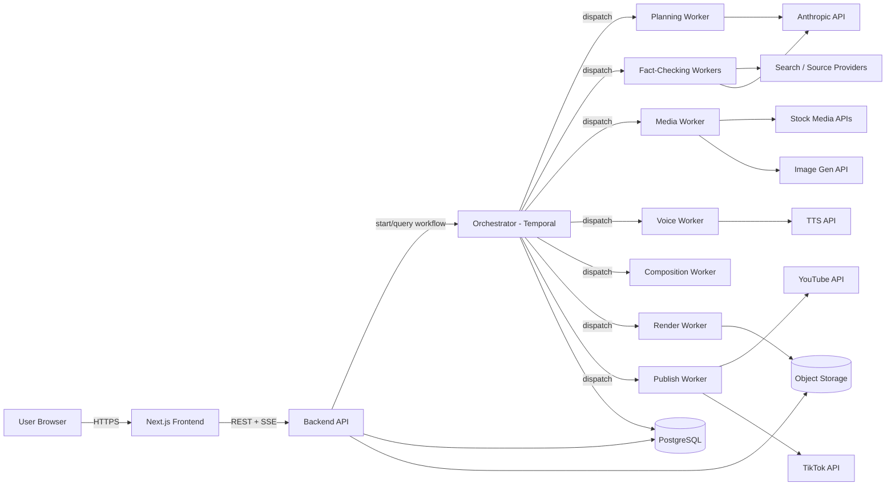
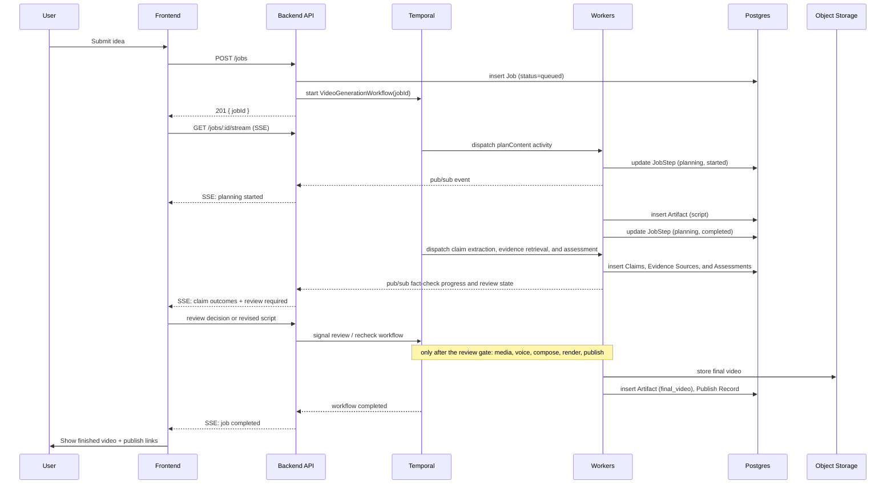
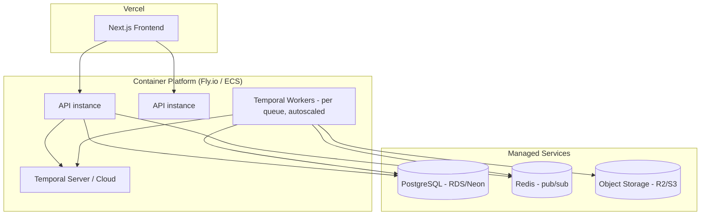
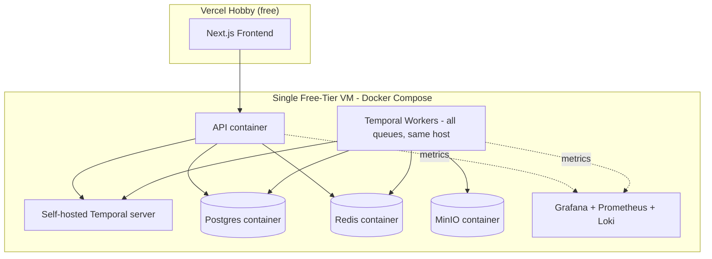

# e2ecg — Architecture Document

Version 1.0 · Companion to `README.md` · Status: Planning / Pre-implementation

## 1. Purpose and Scope

This document describes the technical architecture for e2ecg in enough detail to start implementation: system boundaries, component responsibilities, data flow, schema, API contracts, orchestration logic, deployment topology, and failure handling. Product requirements are defined in the README and are not repeated here except where needed for context.

The fact-checking layer is a first-class workflow gate: it assesses extracted claims against retrieved evidence and never silently treats missing evidence as proof that a claim is false.

Think of the system as a **restaurant with an expo line**: the frontend is the dining room where customers place and track orders, the backend API is the front counter that takes the order and files it, the orchestrator is the expo who tracks every ticket across every station, and the workers are the stations themselves (grill, salad, plating) — each independently staffed and scaled.

## 2. System Context



Fact-checking workers may use an LLM for structured extraction and evidence assessment, but the assessment remains linked to the retrieved source metadata and excerpts. Retrieved pages are evidence data, not instructions.

## 3. Component Architecture

### 3.1 Frontend — Next.js (TypeScript)

- **App Router**, mixing Server Components (job history, account pages — data fetched server-side from the API) with Client Components (live progress view, forms).
- **Live progress**: subscribes to `GET /jobs/:id/stream` (SSE) and renders per-stage status without polling.
- **State management**: server state via React Query (or SWR) for caching job lists/detail; no global client store needed since most state is server-owned.
- **Auth**: Clerk SDK handles session, exposes a session token the frontend forwards to the backend API on each request.
- **Key routes**:
  - `/dashboard` — job list + filters/search (Server Component, paginated)
  - `/jobs/new` — idea submission form
  - `/jobs/[id]` — live progress + artifact viewer (Client Component for the stream)
  - `/settings/integrations` — YouTube/TikTok connection management

### 3.2 Backend API — NestJS on Node.js

Responsibilities: auth verification, request validation, job CRUD, starting/querying orchestrator workflows, serving artifact metadata, proxying SSE from the orchestrator/event bus to the browser.

Modules:
- `AuthModule` — verifies Clerk session tokens, attaches `userId` to the request context.
- `JobsModule` — `POST /jobs` validates input, writes a `Job` row, starts a Temporal workflow with the job id as workflow id (guarantees one workflow per job — see idempotency note in §7).
- `ClaimsModule` — serves extracted claims, evidence references, assessment outcomes, and review decisions; enforces the owning user's job scope.
- `ArtifactsModule` — signed URL generation for reading objects from storage (never exposes storage credentials to the client).
- `IntegrationsModule` — OAuth flows for YouTube/TikTok, encrypted token storage, token refresh.
- `StreamModule` — subscribes to a per-job Redis pub/sub channel (or Temporal's workflow query API) and forwards events to the browser as SSE.

The API is **stateless** — it holds no in-memory job state — so it can scale horizontally behind a load balancer without sticky sessions (SSE connections are per-request but the underlying job state lives in Postgres/Temporal, not in API process memory).

### 3.3 Orchestrator — Temporal

The orchestrator is the piece that turns "call six APIs in order, handle failures, remember where you left off" from application code into a durable guarantee.

- One **Workflow** definition, `VideoGenerationWorkflow`, per job. Workflow id = `job:{jobId}` (idempotency: starting the same job id twice reuses/rejects the duplicate rather than double-running the pipeline).
- Each pipeline stage is a Temporal **Activity**: `planContent`, `draftScript`, `extractClaims`, `retrieveEvidence`, `assessClaims`, `applyReviewGate`, `reviseScript`, `collectMedia`, `generateVoice`, `composeTimeline`, `renderVideo`, `publishContent`.
- Activities are executed by **Workers** — separate Node.js processes, one deployable per activity type (or grouped by resource profile — see §3.4).
- Temporal handles: automatic retries with exponential backoff per activity, timeouts, and durable state — if a worker process dies mid-render, Temporal reschedules the activity on another worker without losing the workflow's place.
- The workflow emits progress by writing a `JobStep` row to Postgres at the start/end of each activity, and publishing an event to Redis pub/sub for the SSE stream to pick up. Temporal state itself is the source of truth for resumability; Postgres is the source of truth for what the UI displays.

Pseudocode sketch of the workflow:

```typescript
export async function VideoGenerationWorkflow(input: JobInput): Promise<JobResult> {
  await recordStep('planning', 'started');
  const plan = await activities.planContent(input);
  await recordStep('planning', 'completed');

  await recordStep('script_drafting', 'started');
  const script = await activities.draftScript(plan);
  await recordStep('script_drafting', 'completed');

  await recordStep('claim_extraction', 'started');
  const claims = await activities.extractClaims(script);
  await recordStep('claim_extraction', 'completed');

  await recordStep('evidence_retrieval', 'started');
  const evidence = await activities.retrieveEvidence(claims);
  await recordStep('evidence_retrieval', 'completed');

  await recordStep('claim_assessment', 'started');
  const assessments = await activities.assessClaims(claims, evidence);
  await recordStep('claim_assessment', 'completed');

  const review = await activities.applyReviewGate(assessments);
  let approvedScript = script;
  if (review.requiresRevision || review.requiresHumanReview) {
    await recordStep('claim_review', 'waiting');
    await waitForReviewDecision();
    approvedScript = await activities.reviseScript(script, review);
    // Re-run extraction, retrieval, and assessment for approvedScript before continuing.
  }

  const [media, voice] = await Promise.all([
    withStep('media_collection', () => activities.collectMedia(approvedScript)),
    withStep('voice_generation', () => activities.generateVoice(approvedScript)),
  ]);

  const timeline = await withStep('video_composition', () =>
    activities.composeTimeline(approvedScript, media, voice)
  );

  const video = await withStep('rendering', () =>
    activities.renderVideo(timeline)
  );

  const publishResults = await withStep('uploading', () =>
    activities.publishContent(video, input.targetPlatforms)
  );

  return { video, publishResults };
}
```

Media collection and voice generation are independent of each other (both depend on the approved script) and run in parallel. They must not start until the review gate allows the script to proceed. A `supported` outcome may proceed under policy; `contradicted`, `unsupported`, and `insufficient/conflicting` outcomes remain visible and follow the configured revision or human-review path.

### 3.4 Worker Services

Each activity type is deployed as its own worker pool so scaling and resource allocation match the actual cost profile of the work:

| Worker | Resource Profile | Scaling Trigger | Notes |
|---|---|---|---|
| Planning / Script | Low CPU, network-bound (LLM call) | Queue depth | Calls Anthropic API with structured/tool-use output for a typed script object |
| Claim Extraction | Low CPU, network-bound (LLM call) | Queue depth | Extracts checkable claims and script locations; stores extraction metadata and coverage limitations |
| Evidence Retrieval | Low CPU, network-bound | Queue depth + provider quota | Searches permitted sources, stores URLs/metadata and minimal excerpts, and records retrieval failures as incomplete checks |
| Claim Assessment / Review | Low CPU, network-bound (LLM call) | Queue depth | Assesses claims against supplied evidence, assigns the four defined outcomes, and applies the review policy without presenting the model judgment as proof |
| Media Collection | Low CPU, network-bound | Queue depth | Queries stock APIs first; falls back to generative image API only on no-match, per licensing policy |
| Voice Generation | Low CPU, network-bound | Queue depth | Calls TTS provider; stores resulting audio in object storage, writes an `Artifact` row |
| Composition | Medium CPU | Queue depth | Runs Remotion in "calculate metadata" / timeline-assembly mode — produces a render spec, not yet a final video file |
| Render | High CPU (and optionally GPU for hardware-accelerated encoding) | Queue depth + concurrency cap | Runs Remotion's renderer + FFmpeg for final encode; most expensive stage, isolated so it can scale independently and use larger/cheaper spot instances |
| Publish | Low CPU, network-bound, rate-limit sensitive | Queue depth | Wraps YouTube/TikTok upload APIs; enforces per-provider idempotency keys |

Workers are Temporal Worker processes (Node.js), each polling only its own task queue (`e2ecg-planning`, `e2ecg-render`, etc.), which is what allows independent autoscaling per stage.

## 4. Data Flow (Sequence)



## 5. Data Model (Schema-Level Detail)

Extends the conceptual model in the README with concrete types.

```sql
users
  id                uuid primary key
  email             text unique not null
  auth_provider_id  text unique
  profile           jsonb
  created_at        timestamptz default now()

jobs
  id                uuid primary key
  user_id           uuid references users(id)
  idea_input        text not null
  audience          text
  tone              text
  target_platforms  text[]        -- e.g. {youtube, tiktok}
  constraints       jsonb         -- duration, style, cta, language
  status            text not null -- queued|planning|script_drafting|claim_extraction|
                                   -- evidence_retrieval|claim_assessment|review_required|
                                   -- media_collection|voice_generation|video_composition|
                                   -- uploading|completed|failed
  workflow_id       text unique   -- Temporal workflow id, = 'job:' || id
  created_at        timestamptz default now()
  updated_at        timestamptz default now()

job_steps
  id                uuid primary key
  job_id            uuid references jobs(id)
  step_name         text not null
  status            text not null  -- pending|started|completed|failed|retrying
  started_at        timestamptz
  finished_at       timestamptz
  error_detail      jsonb
  retry_count       int default 0

script_versions
  id                uuid primary key
  job_id            uuid references jobs(id)
  version_number    int not null
  content           jsonb not null
  revision_reason   text
  created_at        timestamptz default now()

claims
  id                uuid primary key
  job_id            uuid references jobs(id)
  script_version_id uuid references script_versions(id)
  claim_text        text not null
  location          jsonb not null       -- paragraph, sentence, or segment
  claim_type        text
  extraction_meta   jsonb
  outcome           text not null         -- supported|contradicted|unsupported|
                                         -- insufficient_or_conflicting
  rationale         text
  assessment_meta   jsonb                 -- model/provider version, assessment time
  created_at        timestamptz default now()
  updated_at        timestamptz default now()

evidence_sources
  id                uuid primary key
  claim_id          uuid references claims(id)
  url               text not null
  title             text
  publisher         text
  published_at      timestamptz
  retrieved_at      timestamptz not null
  excerpt           text                  -- only where permitted by source terms
  direction         text                  -- supports|contradicts|context
  quality_notes     text
  content_hash      text

claim_reviews
  id                uuid primary key
  claim_id          uuid references claims(id)
  decision           text not null         -- accept|revise|remove|request_review
  reviewer_type     text not null          -- user|system
  rationale         text
  resulting_script_version_id uuid references script_versions(id)
  created_at        timestamptz default now()

artifacts
  id                uuid primary key
  job_id            uuid references jobs(id)
  type              text not null  -- script|evidence_report|image|clip|voice|final_video
  uri               text not null  -- object storage key
  metadata          jsonb          -- duration, resolution, voice provider, etc.
  created_at        timestamptz default now()

platform_accounts
  id                uuid primary key
  user_id           uuid references users(id)
  provider          text not null  -- youtube|tiktok
  access_token_enc  bytea not null
  refresh_token_enc bytea
  token_expiry      timestamptz
  created_at        timestamptz default now()

publish_records
  id                uuid primary key
  job_id            uuid references jobs(id)
  provider          text not null
  remote_content_id text
  remote_url        text
  idempotency_key   text unique not null
  published_at      timestamptz
  response_summary  jsonb
```

Indexes worth adding immediately: `jobs(user_id, created_at desc)` for history browsing, `job_steps(job_id)`, `claims(job_id, script_version_id)`, `evidence_sources(claim_id)`, `claim_reviews(claim_id, created_at desc)`, and `artifacts(job_id)`.

## 6. API Contracts (Key Endpoints)

### `POST /jobs`
```json
// Request
{
  "ideaInput": "5 productivity tips for remote workers",
  "audience": "young professionals",
  "tone": "energetic",
  "targetPlatforms": ["youtube", "tiktok"],
  "constraints": { "durationSeconds": 60, "language": "en", "cta": "Follow for more" }
}
// Response 201
{ "jobId": "b1e2...", "status": "queued" }
```

### `GET /jobs/:id/stream` (SSE)
```
event: step_update
data: {"step":"planning","status":"started","timestamp":"..."}

event: step_update
data: {"step":"planning","status":"completed","timestamp":"..."}

event: fact_check_update
data: {"step":"claim_assessment","status":"review_required","claimCount":4,"flaggedCount":2,"timestamp":"..."}

event: job_completed
data: {"jobId":"b1e2...","status":"completed","artifacts":[...]}
```

### Claims and Evidence
- `GET /jobs/:id/claims` — returns claims for the latest or requested script version, including outcome and review state.
- `GET /claims/:id` — returns the claim, script location, assessment rationale, and audit metadata.
- `GET /claims/:id/evidence` — returns source metadata, excerpts where permitted, retrieval timestamps, and evidence direction.
- `POST /claims/:id/review` — records `accept`, `revise`, `remove`, or `request_review`; user decisions are immutable audit records.
- `POST /jobs/:id/recheck` — creates a new assessment set after a script revision without overwriting prior results.

### `POST /jobs/:id/retry`
Re-signals the existing Temporal workflow to retry from the failed activity rather than starting a new workflow — preserves already-completed artifacts (script, media, voice) instead of regenerating everything.

### `POST /jobs/:id/publish`
```json
// Request
{ "providers": ["youtube"] }
// Response 202 — publish activity enqueued, progress via SSE as usual
```

## 7. Idempotency and Retry Strategy

- **Workflow-level idempotency**: Temporal workflow id = `job:{jobId}`. Starting a workflow with an id already in use returns the existing workflow handle instead of creating a duplicate — this makes `POST /jobs/:id/retry` safe to call multiple times.
- **Activity-level retries**: each activity has a retry policy (initial interval, backoff coefficient, max attempts) tuned per activity — e.g., LLM calls retry aggressively on 429s, retrieval retries transient provider failures, and publish activities retry conservatively given platform rate limits.
- **Fact-check failure semantics**: a retrieval timeout/provider error is an incomplete check, not an `unsupported` outcome. The workflow records the failure and follows the configured review policy; it never bypasses the review gate silently.
- **Revision/recheck idempotency**: each script revision creates a new `script_versions` row and a new claim/evidence assessment set. Prior assessments and review decisions remain immutable audit history, while the latest version determines whether production may continue.
- **Publish idempotency**: a deterministic `idempotency_key` (hash of `jobId + provider`) is passed to the upload activity and stored on the `publish_records` row before the network call is made, so a retried publish activity can check "did I already succeed?" before re-uploading and creating a duplicate video on the platform.

## 8. Storage Layout

Object storage (S3-compatible) organized by job for easy lifecycle management and access control:

```
/{userId}/{jobId}/script.json
/{userId}/{jobId}/fact-check/{scriptVersionId}/report.json
/{userId}/{jobId}/media/{assetId}.mp4|.jpg
/{userId}/{jobId}/voice/narration.mp3
/{userId}/{jobId}/render/final.mp4
/{userId}/{jobId}/render/final_captions.srt
```

- Access is via short-lived signed URLs issued by the API — the client never talks to storage directly.
- A lifecycle policy can move `media/*` (often re-derivable) to cheaper/cold storage after N days while keeping `render/final.mp4` (the user-facing deliverable) in standard storage.

## 9. Real-Time Updates (Event Schema)

Workers publish to a Redis pub/sub channel keyed by `job:{jobId}:events`. The API's `StreamModule` subscribes per active SSE connection and relays events. Event shape:

```json
{
  "jobId": "b1e2...",
  "step": "video_composition",
  "status": "started" ,
  "timestamp": "2026-08-20T10:15:00Z",
  "meta": { "retryCount": 0 }
}
```

Fact-check events include claim counts and review transitions, while claim/evidence rows remain the source of truth for details. Events are also durably written to `job_steps`, so a user who refreshes mid-job (missing live events) gets the same picture from a plain `GET /jobs/:id/steps` and claims query — SSE is a convenience layer, not the source of truth.

## 10. Deployment Modes: Provider Abstraction and Local Configuration Menu

Every external dependency in this system — LLM, TTS, storage, auth, email, orchestration backend — is accessed through a small interface rather than being called directly. This is what makes it possible to run the entire pipeline on either **free, self-hosted services** or **paid, managed services** without touching business logic. Think of each provider interface as a standard wall socket: the workflow code just plugs in, and it doesn't care whether the electricity behind the wall comes from the grid (paid, managed) or a generator you're running yourself (free, self-hosted) — as long as the plug shape matches.

### 10.1 Provider Interfaces

```typescript
interface LLMProvider {
  generatePlan(input: JobInput): Promise<ContentPlan>;
  draftScript(plan: ContentPlan): Promise<Script>;
  extractClaims(script: Script): Promise<ExtractedClaim[]>;
  assessClaims(claims: ExtractedClaim[], evidence: EvidenceSource[]): Promise<ClaimAssessment[]>;
}

interface EvidenceProvider {
  search(claim: ExtractedClaim): Promise<EvidenceSource[]>;
}

interface TTSProvider {
  synthesize(script: Script, language: string): Promise<AudioAsset>;
}

interface ImageGenProvider {
  generate(prompt: string): Promise<ImageAsset>;
}

interface StorageProvider {
  putObject(key: string, data: Buffer): Promise<string>;
  getSignedUrl(key: string, expirySeconds: number): Promise<string>;
}

interface AuthProvider {
  verifySession(token: string): Promise<{ userId: string }>;
}

interface EmailProvider {
  send(to: string, subject: string, body: string): Promise<void>;
}
```

### 10.2 Implementations Per Mode

| Interface | Paid Implementation | Free Implementation |
|---|---|---|
| `LLMProvider` | `AnthropicLLMProvider` (Claude via Anthropic API) | `OllamaLLMProvider` (self-hosted Llama 3.1/Mistral) or `GroqLLMProvider` (free tier, open models) |
| `EvidenceProvider` | Search API or licensed data provider | Search provider with a usable free tier, or limited documented source retrieval |
| `TTSProvider` | `ElevenLabsProvider` | `PiperTTSProvider` or `EdgeTTSProvider` |
| `ImageGenProvider` | `ReplicateImageProvider` | `StableDiffusionLocalProvider` (ComfyUI on the free VM) or disabled — stock-only fallback |
| `StorageProvider` | `S3StorageProvider` (AWS S3 / Cloudflare R2) | `MinioStorageProvider` (self-hosted, S3-compatible API, same interface) |
| `AuthProvider` | `ClerkAuthProvider` | `AuthJsProvider` (self-hosted NextAuth/Auth.js against Postgres) |
| `EmailProvider` | `ResendEmailProvider` | `SmtpEmailProvider` (free-tier SMTP relay) |
| Orchestration target | Temporal Cloud connection | Self-hosted Temporal server (Docker) — same Temporal SDK, different `TEMPORAL_ADDRESS` |

A factory resolves the correct implementation at startup, based on a single environment variable:

```typescript
export function getLLMProvider(): LLMProvider {
  return process.env.DEPLOYMENT_MODE === 'free'
    ? new OllamaLLMProvider(process.env.OLLAMA_HOST)
    : new AnthropicLLMProvider(process.env.ANTHROPIC_API_KEY);
}
```

Every provider follows this same pattern, so `DEPLOYMENT_MODE` is the single source of truth for which services the whole app talks to. Activities and API modules depend only on the interfaces (`LLMProvider`, `StorageProvider`, etc.), never on a concrete class — standard dependency inversion, which is what keeps this swap from leaking into workflow or business logic.

### 10.3 Local Configuration Menu

A setup script, `scripts/configure.ts`, run via `npm run configure`, gives the developer an interactive menu instead of hand-editing environment files:

```
$ npm run configure

e2ecg setup
? Choose a deployment mode:
  ❯ Free   — self-hosted, zero recurring cost, more manual ops
    Paid   — managed services, less ops, costs scale with usage

? Free mode selected. Where will this run?
  ❯ Single local/free-tier VM (Docker Compose)
    Local development machine only

Writing .env.local ...
Writing docker-compose.free.yml service selection ...

Done. Next steps:
  docker compose -f docker-compose.free.yml up -d
  npm run dev
```

Behavior:
- Selecting **Free** writes `DEPLOYMENT_MODE=free` plus the free-mode connection settings (`OLLAMA_HOST`, `MINIO_ENDPOINT`, local Postgres/Redis URLs, self-hosted Temporal address) to `.env.local`, and points the developer at `docker-compose.free.yml`, which stands up Postgres, Redis, MinIO, a self-hosted Temporal server, and Grafana/Prometheus/Loki as containers alongside the API and workers.
- Selecting **Paid** writes `DEPLOYMENT_MODE=paid` and prompts for the managed-service credentials it needs (Anthropic API key, ElevenLabs key, Clerk keys, S3/R2 credentials, Temporal Cloud namespace, Resend key), validating each key with a lightweight ping call before saving.
- The menu can be re-run at any time; it never deletes existing `.env.local` values it doesn't need to change, so a developer can also hand-mix providers (e.g., paid LLM with free storage) by editing `.env.local` after running the menu once.
- The same `DEPLOYMENT_MODE` variable is read by the Docker Compose files, the Next.js app, the API, and every worker, so there is exactly one switch to flip.

## 11. Deployment Topology

### 11.1 Paid Mode



- **Frontend** on Vercel — global edge network, no server management.
- **API** deployed as 2+ instances behind a load balancer, stateless, autoscales on CPU/connection count.
- **Temporal**: use Temporal Cloud initially to avoid operating the Temporal server yourself; migrate to self-hosted only if cost or data-residency requires it.
- **Workers**: one autoscaling group per task queue, so `render` workers (expensive, CPU-heavy) scale independently from `planning` workers (cheap, I/O-bound). Render workers are a good candidate for spot/preemptible instances given Temporal's activity retry already tolerates worker loss.
- **Postgres**: managed (RDS, Neon, or Supabase) with automated backups; add a read replica once history/search queries start competing with write-heavy job traffic.
- **Redis**: managed instance, used only for pub/sub and any lightweight BullMQ queues (e.g., outbound email) — not for durable job state.

### 11.2 Free Mode



Everything except the frontend runs on a single free-tier VM (e.g., an Oracle Cloud "Always Free" ARM instance) as Docker Compose services, defined in `docker-compose.free.yml` (see §10.3). This is deliberately a monolithic topology — no autoscaling, one host is a single point of failure — but it costs nothing to run and is enough to develop and demo the full pipeline end-to-end.

- All Temporal workers run as containers on the same host, competing for the same CPU. Fine for low job volume; the render stage is the first thing that will bottleneck as usage grows.
- Because every service sits behind the provider interfaces from §10.1, moving from this topology to the paid topology in §11.1 is a `DEPLOYMENT_MODE` flip plus a data migration (Postgres dump/restore, MinIO → S3/R2 object copy) — not a rewrite.

## 12. Security Architecture

- All inter-service calls over TLS; API validates session tokens on every request via the active `AuthProvider` (Clerk in paid mode, self-hosted Auth.js in free mode).
- OAuth tokens for YouTube/TikTok encrypted at rest using envelope encryption (KMS-managed data key in paid mode; a locally-managed symmetric key in free mode, since there's no managed KMS on a bare VM) — decrypted only inside the publish worker's process memory, never logged.
- Per-user row-level isolation enforced at the query layer (every `jobs`/`artifacts` query scoped by `user_id` derived from the authenticated session, not from client input).
- Apply the same authorization scope to claims, evidence sources, script versions, and review decisions; never trust a client-provided `job_id` or claim ownership.
- Signed, short-TTL URLs for all storage reads/writes — no long-lived public buckets, whether the backing store is S3/R2 or self-hosted MinIO.
- Content safety filter (moderation API call, or a self-hosted moderation model in free mode) runs as an activity between `composeTimeline` and `publishContent`, so generated content is checked before it ever reaches a platform's public API.

## 13. Observability

- **Tracing**: OpenTelemetry spans across API → Temporal workflow → activities. Paid mode exports to Grafana Cloud or Datadog; free mode exports to a self-hosted Grafana + Prometheus + Loki stack running as containers on the same free VM. Either way, a single trace should let you click from "job took 4 minutes" down to "the render activity took 3 of those minutes."
- **Metrics**: per-stage duration histograms, per-stage failure rate, external/local provider latency (LLM, TTS, stock media, YouTube, TikTok) and quota/rate-limit consumption — feeds directly into the README's "failure rate per pipeline stage" and "publish success rate by platform" success metrics.
- **Logging**: structured JSON logs from every worker, correlated by `jobId` and Temporal `workflowId`/`runId`.
- **Alerting**: threshold alerts on stage failure rate and on queue depth per task queue (a growing `render` queue with flat worker count is the first sign you need to scale that pool — in free mode, it's a sign you've outgrown a single VM).

## 14. Open Questions / Decisions to Revisit

- Self-hosted Temporal vs Temporal Cloud — revisit once volume or cost projections are clearer.
- Whether composition (Remotion timeline assembly) and rendering should be one activity or two — currently split so a composition bug doesn't waste an expensive render, but this adds a hop; worth revisiting after real timing data exists.
- GPU-accelerated encoding for render workers — evaluate once render duration/cost becomes a bottleneck; not needed for MVP volumes.
- Free-mode LLM quality — self-hosted open-weight models will likely need more prompt tuning than Claude to reliably produce well-structured scripts; worth budgeting extra iteration time if free mode is the primary target rather than just a dev/demo path.
- Free-mode single point of failure — acceptable for MVP/demo use; revisit before onboarding real users on free mode, since there's no redundancy if the VM goes down.